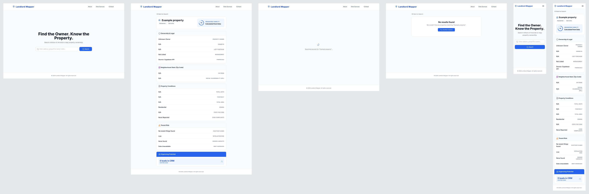

# Texas Landlord Mapper design
Design files for Landlord Mapper, an [Open Austin](https://www.open-austin.org/) project. This repository holds no application code; the code lives in two sibling repositories:

| Repository | Contents |
| --- | --- |
| [open-austin/landlord-mapper](https://github.com/open-austin/landlord-mapper) | Data pipeline |
| [open-austin/landlord-mapper-frontend](https://github.com/open-austin/landlord-mapper-frontend) | Web frontend |

## What's here
- [Wireframes on Penpot](https://design.penpot.app/#/workspace?team-id=10eaca95-0233-815b-8008-d848112247e7&file-id=10eaca95-0233-815b-8008-d84ed886c1ba&page-id=10eaca95-0233-815b-8008-d84ed886c1bb) is the live, editable design file in the LandlordMapper Penpot team; access follows that team's membership. Work in progress lives on its **Workshop** page and finished boards move to **Showroom**.
- `Wireframes.penpot` is a native export of that file, for archiving or importing into another Penpot instance. Git history records when it was exported.
- `exports/` holds PNG exports of boards, for reading without Penpot.
- `design-tokens/` holds the file's design tokens, one JSON file per palette.
- [TODO.md](TODO.md) indexes active work; `docs/` holds policies, spike notes, scratch notes and archives.
- `project-workflows/` is a Git submodule with the shared procedures this project uses to organize its documentation and work. [AGENTS.md](AGENTS.md) explains how it is used here.

## Current-state boards
Six boards reproduce the existing frontend as it is, without proposed changes, so the team has a shared starting point. They mirror [open-austin/landlord-mapper-frontend at `de3fa4f`](https://github.com/open-austin/landlord-mapper-frontend/tree/de3fa4f439888035d58d10d3151c1767fd3a8eb2).



| Board | Export | Size |
| --- | --- | --- |
| Current state · Home · Desktop 1440 | [PNG](exports/current-state-home-desktop.png) | 1440 × 900 |
| Current state · Property result · Desktop 1440 | [PNG](exports/current-state-property-result-desktop.png) | 1440 × 2049, full page |
| Current state · Result loading · Desktop 1440 | [PNG](exports/current-state-result-loading-desktop.png) | 1440 × 1049 |
| Current state · No match · Desktop 1440 | [PNG](exports/current-state-no-match-desktop.png) | 1440 × 900 |
| Current state · Home · Mobile 390 | [PNG](exports/current-state-home-mobile.png) | 390 × 844 |
| Current state · Property result · Mobile 390 | [PNG](exports/current-state-property-result-mobile.png) | 390 × 2241, full page |

Each board is grouped by page section (Header, Hero, Search, Property summary, Ownership & Legal, Neighborhood Stats (Zip Code), Property Conditions, Tenant Risk, Organizing Potential, Footer). Text is live, editable Inter text, and icons are vector paths of the Lucide icons the code imports. A note above each board states its source. The PNGs are exports of the Penpot boards; the overview combines them.

**How they were made.** Layout, copy, colors and section order come from the frontend source at `de3fa4f`: `Home.jsx`, `SearchBar.jsx`, `LocationResult.jsx` (active code only), `InfoRow.jsx`, `Header.jsx`, `Footer.jsx` and `landlordService.js`. A source inventory turned them into layout data, the boards were drawn from that data as native Penpot layers through Penpot's MCP server, and they were then checked against exports of the boards. They were not captured from the deployed site, and the frontend was not run, so exact CSS layout, hover and focus states, animation and live data are unverified.

**Example data.** The result boards show what the frontend displays for a made-up record whose only field is `situs_address: "Example property"`. Every other value is the code's fallback text, including `75`, `Calculated from Data`, `Unknown Owner`, `N/A`, `Not Listed`, `Source: Supabase API`, `Residential`, `None Reported`, `No recent filings found`, `Low`, `None found`, `Data Unavailable` and `0 leads in CRM`. None of it describes a real property, owner or tenant.

**Known differences from the running site.**
- **Font.** The Tailwind config lists Inter first but the app never loads it, so most visitors see their system font (San Francisco on macOS, Segoe UI on Windows, Roboto on Android). The boards use Inter.
- **Line breaks.** Wrapped text, such as the home headline and long mobile labels, breaks where the preparation estimated it would; Penpot does not reflow it like a browser.
- **Mobile placeholder.** The mobile search field shows the placeholder shortened to fit. The source string is `Enter address, group ID or owner name...`, which the browser clips at the field edge.
- **Simplified details.** The code's shadows on the header, search field and result cards are omitted, and the score ring approximates the SVG dash used in the code.

Not reproduced: the About, Data Sources and Contact pages, the open mobile menu, hover/focus/validation states, the error route, and variants with live data.

## Design tokens
`design-tokens/` holds an export of the Wireframes file's design tokens, one file per palette: `color`, `type`, `spatial` and `effect`. They capture the frontend's current visual values, and the `type` palette names the roles text plays across the site, from `type.display` to `type.caption`. They record the product's current visual language and will change as it does.

### Refresh the token snapshot
[penpot-export.json](penpot-export.json) is this project's export configuration. It selects `Wireframes.penpot`, its exact Penpot file ID, the four palettes and six JSON destinations. The reusable implementation lives in [Agent Hands](https://github.com/jcklpe/agent-hands), under `use-penpot/scripts/export_tokens.py`; it is not copied into this repository. Use an Agent Hands checkout containing that command, with Python 3.9+ on macOS or Linux. No account credentials or MCP setup are needed for archive extraction.

After refreshing the native archive from the intended hosted file, run from this repository:

```sh
python3 /path/to/agent-hands/use-penpot/scripts/export_tokens.py --manifest penpot-export.json
```

Review the JSON report's output paths, actions and checksums. To apply a changed plan, use its `plan_sha256` in the same command with `--execute --expect-plan <plan_sha256>`. A stale plan fails before writing. Unchanged files retain their bytes. The exporter never deletes files; each changed file is replaced atomically, and a partial failure reports completed paths. Review any changes and refresh the PNG exports separately from the same Penpot state.

This command extracts the local archive; it does not fetch the live file, prove freshness, or regenerate boards/images. The [implementation record](docs/active-spikes/penpot-token-export.md) tracks verification and publication status. Other projects can use their own manifest with the same tool; source IDs and output paths are data, not executable code.

## Getting started
Clone with submodules:

```sh
git clone --recurse-submodules https://github.com/open-austin/Texas-LandlordMapper-design.git
```

The recorded workflow revision is published, and an anonymous recursive clone retrieved it successfully. `git submodule update --init --recursive` checks out that exact revision and may leave a detached HEAD. See the [adoption record](docs/active-spikes/project-workflows-adoption.md) for the content review, publication evidence and remaining client checks.

For local collaborator setup, use the adopted [Get started guidance](project-workflows/README.md#get-started). Start contribution work with [Coordinate Project Contribution](project-workflows/coordinate-project-contribution/SKILL.md); each agent keeps its own spike and follows this project’s existing scope and review rules.

## License
[GPL-3.0](LICENSE). The `project-workflows/` submodule is a separate work under its own AGPL-3.0-only license.
